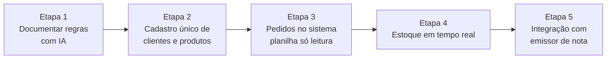
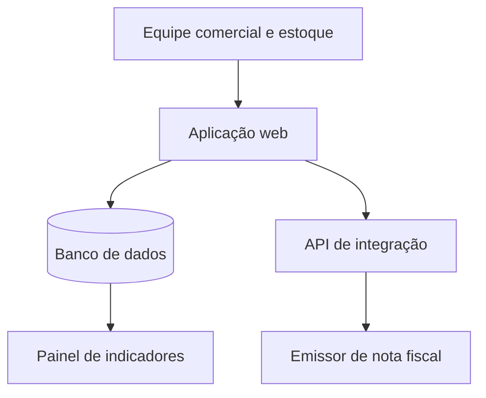

# Case demonstrativo: de planilhas a sistema próprio, sem parar a operação

> ⚠️ **Caso demonstrativo.** A empresa, os números e os nomes abaixo são **fictícios** e servem para mostrar como a TARIQ trabalha. Não representam um cliente real.

## A empresa (fictícia)

**Distribuidora Horizonte** — distribuidora de peças com 60 funcionários, 3 filiais e cerca de 4 mil pedidos por mês. Cresceu rápido e toda a operação passou a rodar em planilhas compartilhadas.

## O problema

- 14 planilhas interligadas por fórmulas e macros que só uma pessoa entende.
- Pedidos digitados duas vezes (planilha + emissor de nota).
- Estoque "fecha" só no fim do mês; vendedores vendem o que não existe.
- Quando a planilha principal corrompe, a operação para meio dia.

## Raio-X (o que mapeamos)

| Item | Achado |
|---|---|
| Fontes de dados | 14 planilhas, 2 macros VBA, 1 emissor de nota fiscal |
| Regras de negócio escondidas | 37 regras em fórmulas (descontos, comissão, frete) |
| Pontos únicos de falha | 1 pessoa, 1 planilha mestre |
| Retrabalho estimado | ~40 h/mês de redigitação e conferência |

## Plano em etapas

Cada etapa entrega valor sozinha. Durante as etapas 2 a 4, **a planilha continua existindo em modo leitura**: ninguém perde o histórico e dá para voltar atrás.

## Arquitetura de chegada (exemplo)

## Resultado esperado (ilustrativo)

- Fim da redigitação de pedidos.
- Estoque confiável no momento da venda.
- Regras de negócio documentadas e versionadas, não presas a uma pessoa.

## Onde entra inovação

A etapa 1 usa IA para ler fórmulas e macros e gerar a documentação das regras de negócio. Quando há incerteza técnica real nesse tipo de trabalho, parte dele **pode** se enquadrar como P&D — veja o [guia da Lei do Bem](https://github.com/tariqtech-br/guia-lei-do-bem-ti). A migração de rotina, por si só, não é P&D.

---

Quer um Raio-X da sua operação? **[tariqtech.com.br](https://tariqtech.com.br)** · contato@tariqtech.com.br

Conteúdo preparado com apoio da Tari, assistente de IA da TARIQ.
